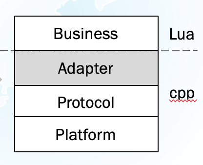
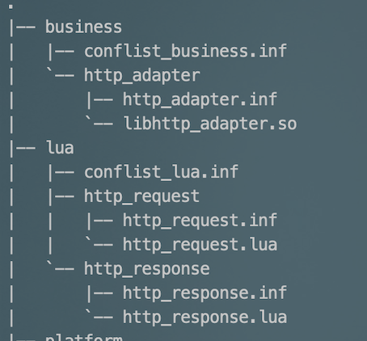

* 简介
    * lua_sapp框架可以看成是lua和sapp平台的一个Adapter。可以使sapp的业务层插件使用lua语言编写。这样做有以下优点:
        * lua是高级语言，语法简单，有自动垃圾回收，对程序员要求低
        * 业务层逻辑由异步回调变成同步阻塞(利用lua的协程提供了一组同步api供业务层调用)
        * 平台内部的数据结构(如stream_info)对业务层透明
        * 增加了程序的健壮性，每个业务层插件运行在自己的lua虚拟机内，各个插件之间相互隔离。
    * 平台层次结构如下图所示
        * 


* 设计思路
    * 基本思路
        * 在设计上，lua_sapp由多个adapter组成，如http_adapter, ssl_adapter，dns_adapter等。
        * 每个adapter都是一个业务层插件，从对应的解析层获取流量(如http_adapter从http解析层获取流量)，然后调用注册了这个adapter的lua脚本。
        * lua脚本在./plug/lua下，通过配置文件中entry_type注册对应的adapter
        * 一个典型的插件组织如下:
            * 


    * 线程/协程模型
        * 每个流(如http stream)对应一个协程
        * m个线程，n个业务层插件，对应 m * n个lua虚拟机
* 安装配置
    * 一键脚本
    
        ```bash
        git clone git@git.mesalab.cn:cuiyiming/lua_sapp.git
        cd lua_sapp && mkdir build && cd build
        cmake -DCMAKE_BUILD_TYPE=Debug ../ && make
        sh ../adapter/http_adapter/script/deploy.sh
        ``` 
* 测试环境
    * 目前192.168.11.137:/home/mesasoft/sapp_run1下面有一套配好的测试环境，直接运行sapp即可看到效果
    * 日志路径: ./log/lua_sapp
* TODO
    * 目前只写了http协议的adapter, 其他如ssl, dns协议的adapter还未编写
    * 目前处于原型阶段，所以大量使用了C++的STL库，需要改成C语言
    * 代码缺少注释，但是可读性还不错，基本可以自解释